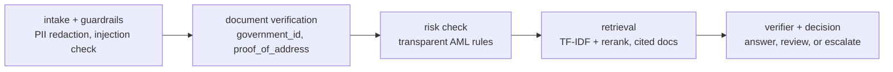

# Agentic Banking Copilot

A production-style agent for banking KYC / onboarding that knows when to
answer on its own — and when to escalate to a human.

Most RAG demos stop at "ask a question, get an answer." This one models
the harder, regulated part: document verification, AML risk rules,
guardrails, cited policy answers, and an auditable decision trace.
Autonomy is a decision, not a default.

**All data is synthetic and invented for this demo.** No real customer
data, no employer code, and no employer data are used. Any numbers below
describe this demo on synthetic data, not any production system.

## The idea in 30 seconds

A synthetic onboarding case goes through named nodes, in order:



Decisions:

| Decision | Meaning |
|---|---|
| `ANSWERED` | Low risk, complete documents, verified citation |
| `ANSWER_WITH_REVIEW` | Answered, but medium risk flags it for human review |
| `REQUEST_DOCUMENTS` | Cannot proceed until missing documents arrive |
| `ESCALATE_TO_HUMAN` | High risk, suspected injection, or no verifiable citation |

The agent does **not** maximise answer rate. It maximises *safe* answer
rate — the cases a production assistant should not answer autonomously
are a feature, not a failure.

## Example

Request:

```bash
curl -X POST localhost:8000/onboarding/run -H 'Content-Type: application/json' -d '{
  "applicant_ref": "SYN-001",
  "question": "What documents are required to open an account?",
  "documents_provided": ["government_id", "proof_of_address"]
}'
```

Response (abridged, verified locally):

```json
{
  "decision": "ANSWERED",
  "answer": "To open an account, an applicant must provide a government-issued photo ID and proof of address dated within the last 90 days. Applications with missing documents are placed on hold until the documents are received and verified.",
  "citations": [{"id": "kyc-documents", "title": "KYC Documents Required for Account Opening"}],
  "confidence": 0.936,
  "risk": {"score": 10, "level": "low", "reasons": ["Baseline onboarding risk: +10"]},
  "trace": ["intake_guardrails: question redacted for trace", "document_verification: missing=none", "risk_check: score=10 level=low", "retrieval: top_doc=kyc-documents confidence=0.936", "decision: ANSWERED"]
}
```

Try a high-risk variant — set `"is_sanctions_match": true` — and the same
endpoint returns `ESCALATE_TO_HUMAN` with no autonomous approval. Remove
`"proof_of_address"` and it returns `REQUEST_DOCUMENTS`.

## Evaluation — synthetic data only

Run it yourself:

```bash
PYTHONPATH=src python scripts/evaluate.py
# writes eval/report.md and eval/results.json
```

Measured locally on `data/eval_qa.jsonl` — 32 synthetic cases
(26 policy questions + 6 decision cases: sanctions, high-risk
jurisdiction + large deposit, missing documents x2, prompt injection,
out-of-scope question):

| Metric | Value |
|---|---|
| Decision accuracy | **1.000** (32 / 32) |
| Citation accuracy (top-1, policy QA) | **0.962** (25 / 26) |
| Answer keyword hit rate (policy QA) | **0.885** (23 / 26) |
| Faithfulness proxy (extractive answer reuses a cited sentence) | **1.000** |
| Autonomous rate (ANSWERED + ANSWER_WITH_REVIEW) | **0.812** |
| Escalation rate | **0.125** |
| Avg latency, local stub retriever | 0.2 ms |
| Avg estimated cost, placeholder $0.002 / 1k tokens | $0.000137 |

Honest limitations, not hidden:

- The one citation miss is genuinely ambiguous: "What counts as
  acceptable proof of address?" retrieves the address-change document
  instead of the KYC document — both contain that phrase.
- Keyword hits are 23 / 26 because answers are extractive: they quote
  policy sentences, so they sometimes miss a paraphrased keyword while
  still citing the right document.
- Latency and cost above are for the local stub retriever, not a hosted
  LLM call. Plug in an LLM and both numbers will change — the harness
  is built to re-measure them, not to hide them.

## Run it

```bash
# Docker (recommended for a reviewer)
docker compose up --build
curl localhost:8000/health

# Or locally
python -m venv .venv && source .venv/bin/activate
pip install -r requirements.txt
PYTHONPATH=src uvicorn agentic_banking_copilot.app:app --reload --port 8000
```

No API key is required. Retrieval and answering are extractive over the
synthetic knowledge base in `data/knowledge_base.json` (12 invented
policy documents: KYC, onboarding, AML, sanctions, PEP, fraud reporting,
servicing).

## Tests

```bash
PYTHONPATH=src python -m pytest -q
# 12 passed
```

Tests cover: guardrail redaction and injection detection, risk levels,
retrieval top-1, all four decisions, the full node trace, and the API.

## Project structure

```
src/agentic_banking_copilot/
  agent.py       # named-node state machine + decision logic
  retrieval.py   # TF-IDF retrieval + rerank + extractive answers
  risk.py        # transparent AML rules (score, level, reasons)
  guardrails.py  # PII redaction, prompt-injection detection
  kb.py          # synthetic knowledge-base loader
  app.py         # FastAPI: /health, /metrics, /onboarding/run
data/
  knowledge_base.json   # 12 synthetic policy documents
  eval_qa.jsonl         # 32 synthetic eval cases
scripts/evaluate.py     # eval harness -> eval/report.md + results.json
tests/                  # 12 tests
eval/report.md          # latest measured eval report
```

## Implementation note

The agent is an explicit state machine with named nodes and a trace,
not a LangGraph dependency. That is deliberate: it keeps the demo
offline, deterministic, and testable without an LLM key, while keeping
the node boundaries exactly where a LangGraph graph would put them —
so swapping in LangGraph later changes the dispatcher, not the logic.
If you want the LangGraph version, that is the natural next step, and
the eval harness will show whether it changes any decision.

## Background and scope

This project is inspired by production banking-assistant work
(RAG assistants for KYC / onboarding / servicing, AML rule engines,
and explainable reporting) and rebuilt here from scratch with
synthetic data only. It is not a copy of any production system, and
production outcomes from that work are not claimed as demo results.

## Next steps worth doing

1. Plug in an LLM provider behind the verifier, keeping extractive
   citations as the ground truth and re-running the eval harness.
2. Replace TF-IDF with a vector store (e.g. Qdrant / pgvector) and
   measure whether top-1 citation accuracy actually improves.
3. Add a second agent for transaction monitoring that shares the same
   risk and escalation logic.
